# Showcraft

[](https://nxtg-ai.github.io/ShowCraft/?embed=1&mode=playable)

> **60fps Auto-Zoom Launch Video & Interactive Product Sandbox Studio** — Turn a 15-second UI walkthrough into a spring-zoomed `.webm` launch video and a zero-install playable sandbox.
>
> **[Try the Live Interactive Sandbox →](https://nxtg-ai.github.io/ShowCraft/?embed=1&mode=playable)** · **[Open Studio Workbench →](https://nxtg-ai.github.io/ShowCraft/)** · **[Read the User Guide →](./docs/USER_GUIDE.md)**

---

## Features

- **4-Zone NLE Studio Workbench:** Precision dark-mode and daylight-adaptive interface (`#09090b` obsidian surface, tabular monospace timecodes, 4-track keyframe timeline).
- **Automatic Dead-Air Compression:** Excises hesitation and idle pauses (`> 800ms`) between clicks and normalizes pacing into crisp studio beats.
- **Critically-Damped Spring Camera:** Computes smooth 60Hz telephoto magnification (`1.20×` to `2.15×`) and focal pan trajectories centered on your interaction vectors.
- **Direct Timeline & Canvas Editing:** Drag camera zoom or caption blocks horizontally on the timeline to re-time beats, or click directly on the canvas to reposition a step's focal anchor.
- **Live 60fps Screen / Tab Capture (`getDisplayMedia`):** Stream any browser tab or desktop window directly into the floating studio frame at 60fps, or record any website with the unpacked Manifest V3 Chrome Extension ([`./extension`](./extension)).
- **Dual-Mode Output:**
  - **Cinema Compositor (`1`):** Export 60fps `VP9/Opus` `.webm` videos with dark or high-key daylight studio mattes, procedural WebAudio UI click/whoosh SFX, and timecoded lower-third subtitles.
  - **Interactive Sandbox (`2`):** Share `< 2 KB` stateless `#scraft=` URLs or animated SVG cards where viewers click pulsing hotspots to step through your workflow firsthand.
- **Optional Gemini 3.8 Flash & TTS Integration:** Bring your own `GEMINI_API_KEY` (stored strictly in volatile browser session memory) to synthesize punchy launch hooks, camera zoom choreography, and `gemini-3.8-flash-tts` voiceover tracks.

---

## Quickstart

### Prerequisites
- **Node.js** `>= 20.x`

### Run Locally
```bash
git clone https://github.com/nxtg-ai/ShowCraft.git
cd ShowCraft
npm install
npm start
```
Open **`http://localhost:3456`** in your browser.

### Run Verification Suite
```bash
npm test
```

---

## Documentation

- **[User Guide (`docs/USER_GUIDE.md`)](./docs/USER_GUIDE.md)** — Complete walkthrough of recording, timeline editing, live screen capture, voiceover synthesis, and exporting.
- **[Changelog (`CHANGELOG.md`)](./CHANGELOG.md)** — Release history.

---

## License

MIT — see [LICENSE](./LICENSE).
